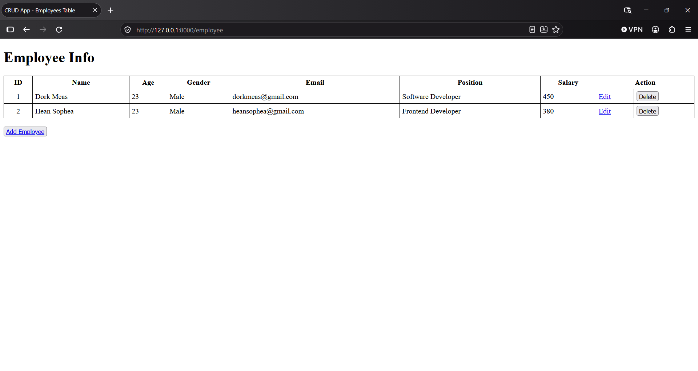
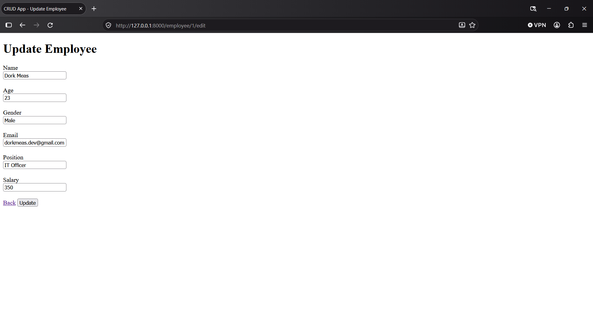
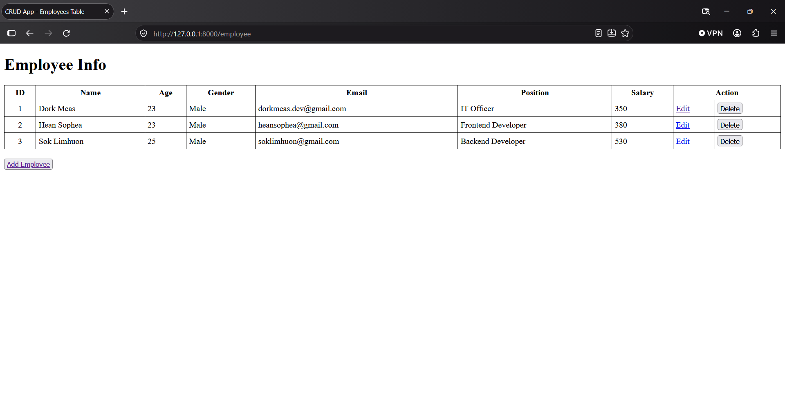

# Laravel Employee CRUD

A simple web-based Employee CRUD application built with **Laravel 13** and **PHP 8.3+**. This project demonstrates fundamental Create, Read, Update, and Delete (CRUD) operations using Laravel's MVC architecture, Eloquent ORM, Blade templates, and database migrations.

## Project Status

**Completed**

This project has been completed and is no longer under active development. It is preserved as a practical learning project and a reference for fundamental Laravel application development.

## Overview

Laravel Employee CRUD is a web application for managing employee records. It provides basic functionality to create, display, update, and delete employee information.

The project focuses on understanding Laravel's core concepts, including routing, controllers, models, database interactions, form validation, and Blade templating.

## Features

- **Create Employee:** Add new employee records.
- **View Employees:** Display employee information in a structured table.
- **Update Employee:** Edit existing employee information.
- **Delete Employee:** Remove employee records with confirmation.
- **Form Validation:** Validate submitted data on the server.
- **Database Integration:** Store and retrieve records using Eloquent ORM.
- **Blade Templates:** Render dynamic HTML pages.
- **Database Migrations:** Manage database table structures.

## Technology Stack

| Technology | Purpose |
|---|---|
| PHP 8.3+ | Backend programming language |
| Laravel 13 | Web application framework |
| Blade | Server-side templating engine |
| Eloquent ORM | Database interaction |
| SQLite / MySQL | Relational database |
| HTML5 | Page structure |

## Application Screenshots

### Employee List



### Create Employee


### Update Employee



### Employee List - Last Updated


## Project Structure

```text
laravel-employee-crud/
├── app/
│   ├── Http/
│   │   └── Controllers/
│   │       └── EmployeeController.php
│   └── Models/
│       └── Employee.php
├── database/
│   └── migrations/
│       └── create_employees_table.php
├── docs/
│   ├── images/
│   ├── installation.md
│   └── project-overview.md
├── public/
├── resources/
│   └── views/
│       └── employee/
│           ├── create.blade.php
│           ├── edit.blade.php
│           └── index.blade.php
├── routes/
│   └── web.php
├── tests/
├── .env.example
├── artisan
├── composer.json
└── README.md
```

## Installation

See the [Installation Guide](docs/installation.md) for detailed setup instructions.

### Quick Start

```bash
git clone https://github.com/DorkMeas/laravel-employee-crud.git

cd laravel-employee-crud

composer install

cp .env.example .env

php artisan key:generate
```

Configure the database, then run:

```bash
php artisan migrate

php artisan serve
```

Open the application:

```text
http://127.0.0.1:8000
```

**Note:** Node.js and npm are not required to run the current Blade-based application.

## Database Structure

The application uses an `employees` table with the following columns:

| Column | Description |
|---|---|
| `id` | Unique employee identifier |
| `name` | Employee name |
| `age` | Employee age |
| `gender` | Employee gender |
| `email` | Employee email address |
| `position` | Employee job position |
| `salary` | Employee salary |
| `created_at` | Record creation timestamp |
| `updated_at` | Last modification timestamp |

## Application Routes

| Method | URI | Description |
|---|---|---|
| GET | `/` | Redirect to employee listing |
| GET | `/employee` | Display employees |
| GET | `/employee/create` | Show employee creation form |
| POST | `/employee/store` | Store a new employee |
| GET | `/employee/{employee}/edit` | Show employee editing form |
| PUT | `/employee/{employee}/update` | Update employee information |
| DELETE | `/employee/{employee}/destroy` | Delete an employee |

## Learning Objectives

This project demonstrates practical knowledge of:

- Laravel MVC architecture
- Web routing and controllers
- Eloquent ORM
- Database migrations
- Blade templating
- HTTP request methods
- Form handling and validation
- Route model binding
- CRUD operations

## Documentation

- [Installation Guide](docs/installation.md)
- [Project Overview](docs/project-overview.md)

## Author

**Dork Meas**

GitHub: [@DorkMeas](https://github.com/DorkMeas)

---

<p align="center">
  Completed Laravel Learning Project
</p>
