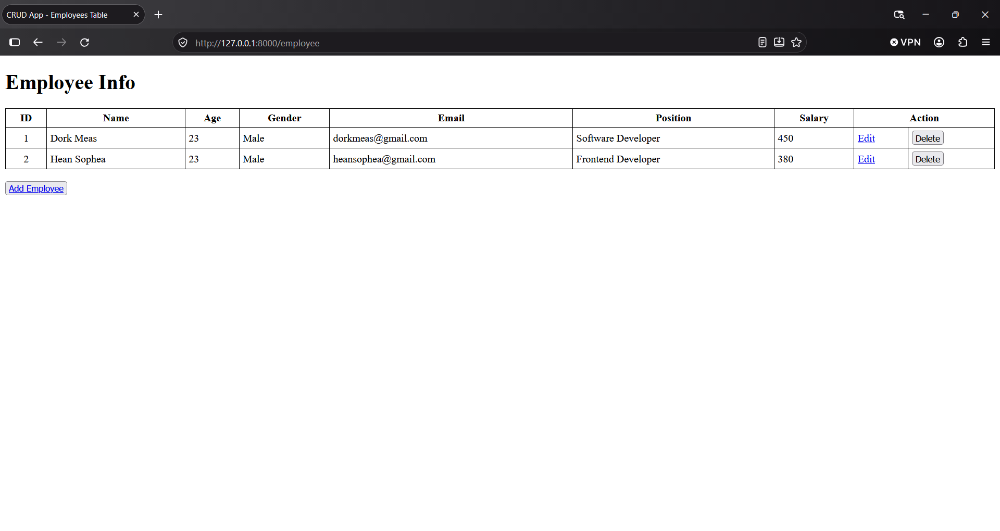
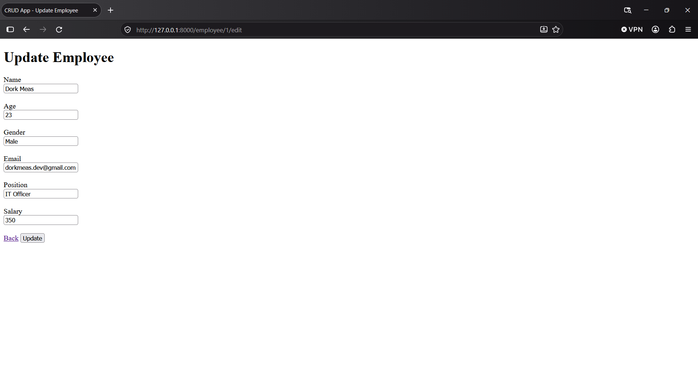
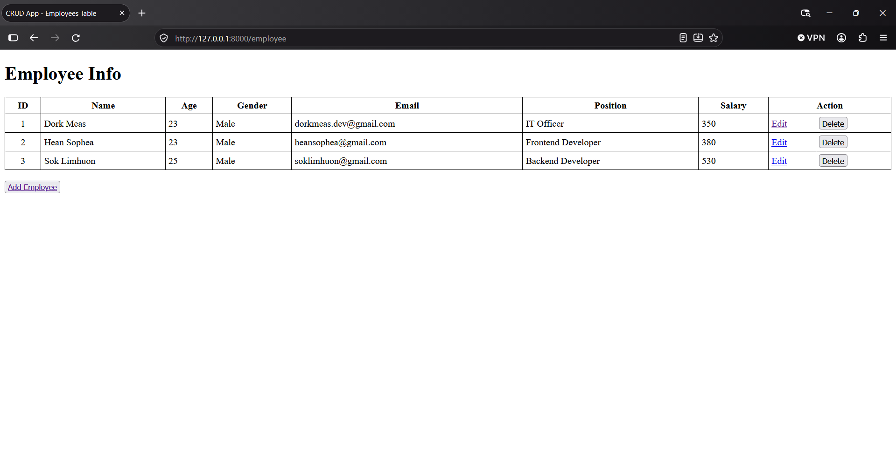

# Project Overview

## Introduction

Laravel Employee CRUD is a web-based application developed using Laravel 13 and PHP.

The application provides basic employee record management functionality through Create, Read, Update, and Delete (CRUD) operations.

This project was developed as a practical learning exercise to understand Laravel's MVC architecture, database integration, routing, controllers, Eloquent ORM, and Blade templating.

## Project Information

| Property | Details |
|---|---|
| Project Name | Laravel Employee CRUD |
| Repository Name | `laravel-employee-crud` |
| Framework | Laravel 13 |
| PHP Requirement | PHP 8.3+ |
| Architecture | Model-View-Controller (MVC) |
| Template Engine | Blade |
| ORM | Eloquent |
| Database | SQLite / MySQL |
| Frontend | HTML |
| Project Type | Learning Project |
| Project Status | Completed |

## Project Objectives

The main objectives of this project are:

- Understand Laravel's MVC architecture.
- Implement fundamental CRUD operations.
- Learn database interactions using Eloquent ORM.
- Understand Laravel routing and controllers.
- Handle HTTP requests and form submissions.
- Implement server-side form validation.
- Render dynamic pages using Blade templates.
- Manage database structures through migrations.

## Core Features

### 1. Create Employee

Allows users to create new employee records by submitting an employee information form.

### 2. View Employees

Displays employee records in a structured HTML table.

### 3. Update Employee

Allows users to edit existing employee information.

### 4. Delete Employee

Allows users to delete employee records with a confirmation prompt.

### 5. Form Validation

Validates submitted employee information on the server before saving or updating records.

## Employee Data Model

The application uses an `Employee` Eloquent model to represent employee records.

### Database Table: `employees`

| Column | Data Type | Description |
|---|---|---|
| `id` | BIGINT | Primary key |
| `name` | VARCHAR | Employee name |
| `age` | INTEGER | Employee age |
| `gender` | VARCHAR | Employee gender |
| `email` | VARCHAR | Employee email |
| `position` | VARCHAR | Employee job position |
| `salary` | DOUBLE | Employee salary |
| `created_at` | TIMESTAMP | Record creation time |
| `updated_at` | TIMESTAMP | Record update time |

## Application Architecture

The application follows the Model-View-Controller (MVC) architectural pattern.

### Model

The `Employee` model represents employee data and provides database interactions through Eloquent ORM.

File:

```text
app/Models/Employee.php
```

### View

Blade templates render the application's HTML pages and display employee information.

Directory:

```text
resources/views/employee/
```

Available views:

- `index.blade.php`
- `create.blade.php`
- `edit.blade.php`

### Controller

The `EmployeeController` handles application requests, validates submitted data, and performs CRUD operations.

File:

```text
app/Http/Controllers/EmployeeController.php
```

### Routes

Web routes define the URLs and HTTP methods used to access employee functionality.

File:

```text
routes/web.php
```

## Request Flow

The application follows this general request lifecycle:

```text
       Browser
          |
          v
      Web Routes
          |
          v
    EmployeeController
          |
          v
      Employee Model
          |
          v
       Database
          |
          v
    EmployeeController
          |
          v
      Blade View
          |
          v
       Browser
```

## HTTP Methods

The application uses the following HTTP methods:

| HTTP Method | Operation | Purpose |
|---|---|---|
| GET | Read | Retrieve and display employee records |
| POST | Create | Store a new employee |
| PUT | Update | Modify an existing employee |
| DELETE | Delete | Remove an employee |

## Application Routes

| Method | URI | Route Name |
|---|---|---|
| GET | `/` | — |
| GET | `/employee` | `employee.index` |
| GET | `/employee/create` | `employee.create` |
| POST | `/employee/store` | `employee.store` |
| GET | `/employee/{employee}/edit` | `employee.edit` |
| PUT | `/employee/{employee}/update` | `employee.update` |
| DELETE | `/employee/{employee}/destroy` | `employee.destroy` |

## Technology Stack

| Technology | Role |
|---|---|
| PHP 8.3+ | Backend programming language |
| Laravel 13 | Web application framework |
| Blade | Server-side templating |
| Eloquent ORM | Database interaction |
| SQLite / MySQL | Relational database |
| HTML5 | Application page structure |

## Project Structure

```text
laravel-employee-crud/
├── app/
│   ├── Http/
│   │   └── Controllers/
│   │       └── EmployeeController.php
│   └── Models/
│       ├── Employee.php
│       └── User.php
├── bootstrap/
├── config/
├── database/
│   ├── factories/
│   ├── migrations/
│   │   ├── 0001_01_01_000000_create_users_table.php
│   │   ├── 0001_01_01_000001_create_cache_table.php
│   │   ├── 0001_01_01_000002_create_jobs_table.php
│   │   └── 2026_11_08_100327_create_employees_table.php
│   └── seeders/
├── docs/
│   ├── images/
│   ├── installation.md
│   └── project-overview.md
├── public/
├── resources/
│   └── views/
│       └── employee/
│           ├── create.blade.php
│           ├── edit.blade.php
│           └── index.blade.php
├── routes/
│   └── web.php
├── tests/
├── .env.example
├── artisan
├── composer.json
└── README.md
```

## Screenshots

Application screenshots are maintained in the `docs/images/` directory.

### Employee List



### Create Employee


### Update Employee



### Employee List - Last Updated


## Learning Outcomes

This project provides practical experience with:

- Laravel MVC architecture.
- Eloquent ORM and database operations.
- Database migrations.
- Web routing and controller implementation.
- Blade template rendering.
- HTTP methods and form submissions.
- Server-side validation.
- Route model binding.
- Fundamental CRUD workflows.

## Project Status

**Completed**

The project has been completed and is no longer under active development. The repository is preserved as a completed Laravel learning project and a reference for fundamental web application development concepts.

## Author

**Dork Meas**

GitHub: [@DorkMeas](https://github.com/DorkMeas)

---

<p align="center">
  Laravel Employee CRUD
</p>
